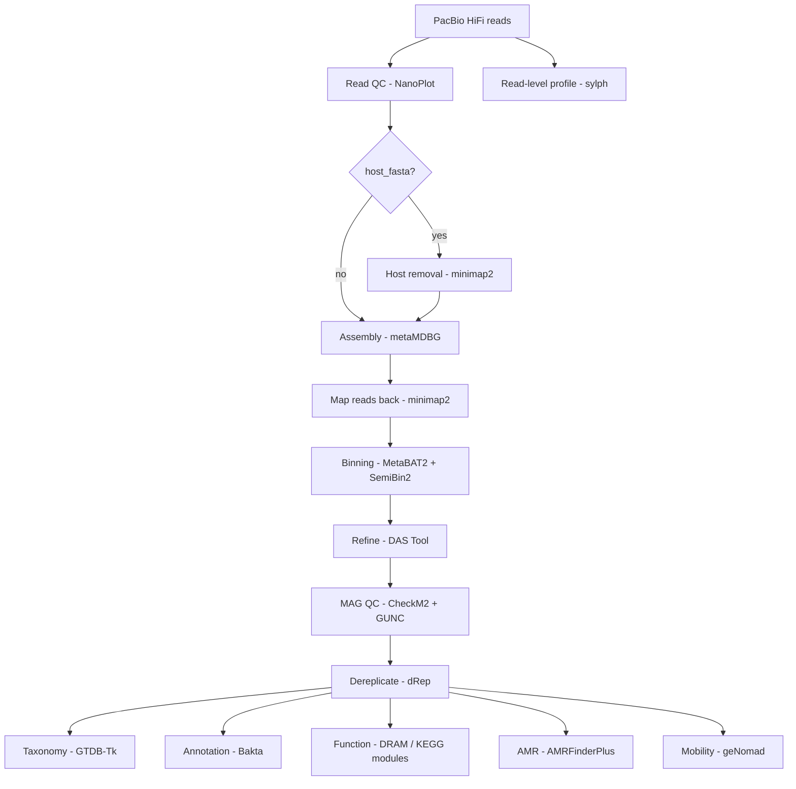

# longread-metagenome-mag

**A reproducible Nextflow (DSL2) pipeline for long-read metagenomics: PacBio HiFi / Nanopore reads → metagenome assembly → genome binning → MAG quality control → taxonomy → function → AMR & mobile elements.**

Demonstrated on a published deep-sea mussel symbiont dataset, the workflow is
written to run unchanged on any host-associated long-read shotgun metagenome
(fish gut, gill, skin mucus, aquaculture samples). All steps run in pinned
Apptainer containers for reproducibility.

> This repository re-analyses **public** data. No raw reads or large
> assemblies are committed — only the sample sheet, workflow code and small
> summary outputs. The original dataset and paper are credited below.

---

## Scientific question

*Chemosynthetic symbionts of the deep-sea mussel* **Gigantidas platifrons** *from long-read metagenomes:*

1. Which MAGs represent the methane- and sulfur-oxidising endosymbionts, and at what MIMAG quality?
2. What is their metabolic potential — C1 and sulfur metabolism, nitrogen, and vitamin (B12) biosynthesis?
3. Do any MAGs carry antimicrobial-resistance (AMR) genes or mobile genetic elements (plasmids / proviruses)?

## Dataset

| | |
|---|---|
| BioProject | **PRJNA891367** |
| Host | *Gigantidas platifrons* (deep-sea mussel, cold-seep, Pacific Ocean) |
| Sample type | gill metagenome (chemosymbiont-bearing tissue) |
| Platform | PacBio Sequel II — ENA serves raw **subreads** (source study generated CCS/HiFi; see note below) |
| Samples | 5 (8.4–19.6 Gb each; see `assets/samplesheet.csv`) |
| Source paper | Sun Y, Wang M, Cao L, *et al.* (2023) *Microbiome* **11(1):253**. **Mosaic environment-driven evolution of the deep-sea mussel *Gigantidas platifrons* bacterial endosymbiont.** DOI: [10.1186/s40168-023-01695-8](https://doi.org/10.1186/s40168-023-01695-8) |

## Workflow



## Quickstart

```bash
# 1. install Nextflow + Apptainer, then:
nextflow run main.nf \
    -profile apptainer,slurm \
    --input assets/samplesheet.csv \
    --platform hifi \
    --host_fasta /path/to/host_genome.fa \
    --checkm2_db ... --gtdbtk_db ... --bakta_db ... \
    --outdir results
```

See [`docs/usage.md`](docs/usage.md) for data download, database setup and the
note on PacBio **subreads vs HiFi** (ENA serves these runs as subreads).

## Repository structure

```
longread-metagenome-mag/
├── main.nf                 # workflow entry point (DSL2)
├── nextflow.config         # params, profiles, manifest, reporting
├── modules/local/          # one file group per stage (QC, assembly, binning, ...)
├── conf/                   # base (containers+resources), slurm, test
├── assets/                 # sample sheet (accessions, no reads)
├── bin/                    # summary + plotting scripts (Python / R)
├── docs/                   # usage, methods, compute notes
├── containers/             # container cache / notes
├── results/                # small summary tables & figures only
├── CITATION.cff
└── LICENSE                 # MIT
```

## Results

*Populated after the server run.* Planned outputs:

- `results/mag_summary.tsv` — completeness, contamination, GUNC pass, GTDB taxonomy, MIMAG tier
- `results/mag_quality.png` — completeness vs contamination
- `results/gene_heatmap.png` — chemosynthesis / B12 / AMR genes by MAG
- `results/pipeline_info/` — Nextflow timeline, trace, resource report

## Limitations

- 5 samples from one host population — a workflow demonstration, not a survey.
- ENA provides subreads; HiFi reads may need regeneration (`pbccs`).
- MAG gene content is descriptive (presence/absence), without replicate statistics.

## Relation to the source study

This repository is an **independent re-analysis** of the public PRJNA891367 reads
using a standard, current long-read MAG workflow. It is **not** a reproduction of
the bespoke pipeline in Sun *et al.* (2023) — the two differ at most stages:

| Stage | Sun *et al.* 2023 | This repo |
|-------|-------------------|-----------|
| Sequencing used | Illumina short-read **+** PacBio HiFi (CCS) | PacBio long-read only (the 5 CCS runs; ENA serves them as subreads) |
| Read handling | CONCOCT k-mer clustering of reads into per-strain subdatasets | whole-sample assembly |
| Assembly | Flye-meta (metaFlye), per cluster | metaMDBG |
| Binning | MetaWRAP (MaxBin2, MetaBAT2, CONCOCT, VAMB, SolidBin, BinSanity) | MetaBAT2 + SemiBin2 -> DAS Tool |
| MAG QC | CheckM | CheckM2 + GUNC |
| dRep | pairwise ANI among assemblies (similarity heatmap) | cross-sample dereplication |
| Taxonomy | GTDB-Tk | GTDB-Tk |

The source study recovered **28 symbiont genomes** (mean completeness 89.2%, mean
size 3.53 Mb) and focused on **within-species (strain-level) variation** of the
methanotrophic endosymbiont across vent and seep habitats. This repo instead
applies a reproducible, container-based community workflow to the same reads — the
aim is a clean, portable pipeline and MAG set, not a re-derivation of the paper's
strain-resolved result.


## License & citation

Code released under the [MIT License](LICENSE). If you use this workflow,
please cite this repository (see [`CITATION.cff`](CITATION.cff)) **and** the
original dataset paper (Sun *et al.* 2023, above).

Pipeline by **Sayed Mashequl Bari** ([@BariSayed](https://github.com/BariSayed)).
